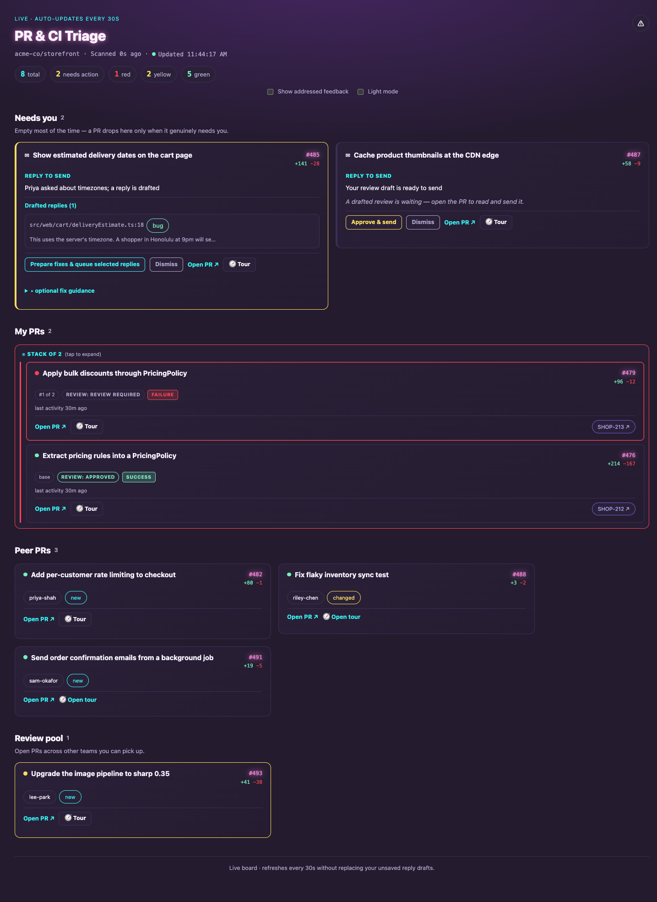

# @mgreten/pr-triage

Open your GitHub PR queue in one browser tab. See CI and review status, related
PRs grouped into stacks, peer PRs, and an optional review pool. Build a guided
code tour of one PR when you click **Tour**; scanning the board never starts an
agent, posts a review, or pushes code.

## Install

```sh
swamp extension pull @mgreten/pr-triage
swamp extension pull @mgreten/pr-tour
```

Read [SETUP.md](SETUP.md), or tell your agent **“Set up Mat’s PR triage
dashboard and tours using this SETUP.md.”** It covers the GitHub login, scope,
local server, and optional agent settings. Keep the board on loopback: it
displays whatever private PRs your GitHub account can read.

## Try the fictional board

From the extensions monorepo, run the same renderer and server against the
fictional `acme-co/storefront` repo:

```sh
deno run --allow-net=127.0.0.1:8897 --allow-env=HOME,DEMO_PORT,DEMO_BUILD_MS \
  packages/pr-triage/demo/serve.ts
```

Open `http://127.0.0.1:8897/`, try Light mode, or click Tour on #482. The demo
does not fetch GitHub data or execute agents. Other action buttons are
simulated; tour pages exist for the three sample PRs used in the walkthrough.



## Configuration

| Setting                 | Default                             | Purpose                                                                     |
| ----------------------- | ----------------------------------- | --------------------------------------------------------------------------- |
| `repo`, `login`         | Required                            | GitHub `owner/repo` and your GitHub login                                   |
| `peers`, `reviewPool`   | `[]`, `false`                       | Show non-draft PRs from selected authors and, optionally, all other authors |
| `limit`                 | `100`                               | Maximum number of open PRs to fetch per scan                                |
| `outputDir`, `toursDir` | `~/.pr-triage`, `~/.pr-tour/pages`  | Snapshot, HTML report, and tour locations                                   |
| `port`, `webhookPort`   | `8765`, `8899`                      | Dashboard and Swamp webhook loopback ports                                  |
| `webhookSecretFile`     | Unset                               | Enables the server-side signing bridge                                      |
| `actionRoutes`          | `{pr-tour: pr-tour}`                | Map from dashboard actions to allowlisted Swamp webhook route names         |
| `issueLinksPath`        | Unset                               | JSON object mapping PR numbers to arrays of `{identifier,title,url}`        |
| `theme`                 | Synthwave dark / GitHub-white light | Override hex colors by CSS token name, without `--`                         |

Example `globalArguments` theme override (apply it to the scan and server
instances):

```yaml
theme:
  dark: { bg: "#101a2b", accent: "#82cfff" }
  light: { accent: "#0553a5" }
```

`scan` stores a versioned board artifact and the report exports `board.json`
(`schemaVersion: 1`; see [BoardSchema](extensions/models/board_schema.ts)). The
server serves the board at `/`, sends lane updates at `/board`, and serves tour
pages at `/tours/`. The browser never receives a webhook signing key.

### Private hooks

Issue links are optional. Have your tracker integration write the mapping to
`issueLinksPath` before scanning. No tracker account is required by the board.

The renderer can also display feedback, drafts and reviewed fix candidates
supplied via the board schema. It does not produce these by itself. The default
installation only configures the tour action. A private integration can map
actions such as `pr-accept-push` to its own workflows via `actionRoutes`. Such
workflows own verification: they must check the exact reviewed candidate and
fail closed before pushing if verification does not pass. Do not map a fix
action straight to an unconditional push.

MIT — see [LICENSE.txt](LICENSE.txt).
